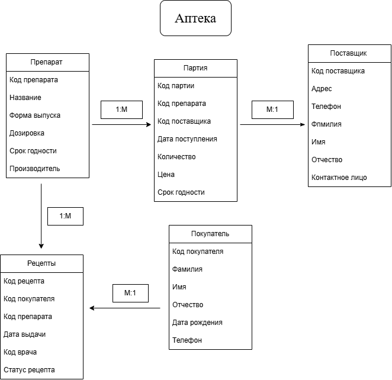

# 1. Содержательное описание предметной области

Аптека — это специализированное медицинское учреждение, которое занимается изготовлением, хранением, контролем качества и отпуском лекарственных препаратов, а также продажей медицинских изделий и других товаров для здоровья. Покупатели приобретают препараты в аптеке. Для препаратов, отпуск которых требует рецепта, оформляется рецепт, связанный с покупателем и соответствующим препаратом. Объектами предметной области являются препараты, поставщики, покупатели, партии и рецепты.

## 2. Сущности и их атрибуты

### Препарат
- Код препарата — числовой, ключевой атрибут
- Название — текстовый
- Форма выпуска — текстовый
- Дозировка — текстовый
- Срок годности — дата
- Производитель — текстовый

### Поставщик
- Код поставщика — числовой, ключевой атрибут
- Адрес — текстовый
- Телефон — текстовый
- ФИО — текстовый
- Контактное лицо — текстовый

### Партия
- Код партии — числовой, ключевой атрибут
- Код препарата — числовой
- Код поставщика — числовой
- Дата поступления — дата
- Количество — числовой
- Цена — числовой
- Срок годности — дата

### Покупатель
- Код покупателя — числовой, ключевой атрибут
- ФИО — текстовый
- Дата рождения — дата
- Телефон — текстовый

### Рецепт
- Код рецепта — числовой, ключевой атрибут
- Код покупателя — числовой
- Код препарата — числовой
- Дата выдачи — дата
- Код врача — числовой
- Статус рецепта — текстовый

## 3. Связи между сущностями

| Связь | Тип | Смысловое содержание |
|---|---|---|
| Препарат — Партия | 1:M | Один препарат может поступать несколькими партиями; каждая партия относится к одному препарату. |
| Поставщик — Партия | 1:M | Один поставщик может поставлять много партий; каждая партия поступает от одного поставщика. |
| Покупатель — Рецепт | 1:M | Один покупатель может иметь несколько рецептов; каждый рецепт относится к одному покупателю. |
| Препарат — Рецепт | 1:M | Один препарат может быть указан в нескольких рецептах; каждый рецепт относится к одному препарату. |

## 4. Сущности — атрибуты — ключ

| Сущность | Атрибуты | Ключ |
|---|---|---|
| Препарат | Код препарата, название, форма выпуска, дозировка, срок годности, производитель | Код препарата |
| Поставщик | Код поставщика, адрес, телефон, ФИО, контактное лицо | Код поставщика |
| Партия | Код партии, код препарата, код поставщика, дата поступления, количество, цена, срок годности | Код партии |
| Покупатель | Код покупателя, ФИО, дата рождения, телефон | Код покупателя |
| Рецепт | Код рецепта, код покупателя, код препарата, дата выдачи, код врача, статус рецепта | Код рецепта |

## 5. Графическая система связей
  
